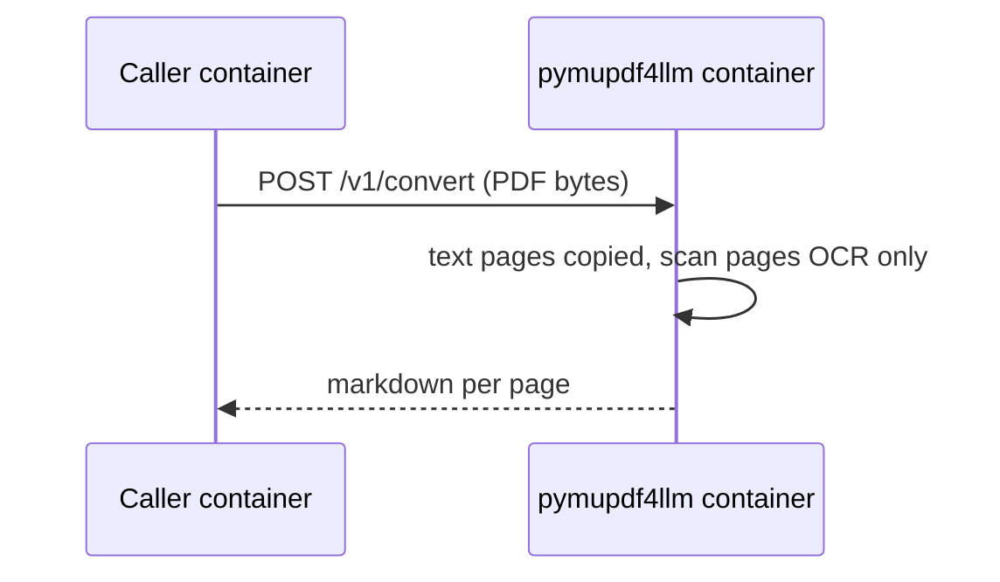

# PyMuPDF4LLM text service

A small HTTP service that turns a PDF into markdown for a language model. Callers send the file and receive text per page. The first caller will be Doc2Graph. Any later service uses the same address.

This document is the build plan. It does not add the client inside Doc2Graph.

## What the service does

1. Accept one PDF over HTTP.
2. Read it with PyMuPDF4LLM (`to_markdown`, `page_chunks=True`).
3. Return one markdown string per page, with the page number.
4. Recognize scans page by page. A text page is copied from the text layer. A page with no selectable text is read by OCR. A photo or diagram on a text page does not send that whole page through OCR.

PyMuPDF4LLM sits on PyMuPDF. The service depends on the PyMuPDF4LLM package. Callers do not import either library.

## License

PyMuPDF and PyMuPDF4LLM are AGPL-3.0. This service links them in-process, so this repository must be AGPL-3.0 as well.

The repository currently contains the GPL-3.0 text in `LICENSE`. That is the wrong license. Before the service is offered on a network, replace it with AGPL-3.0 and name the license in the README. The README must tell a network user where to get this repository's source.

Doc2Graph, chat, and search stay separate programs. They only send a PDF and receive text. Their source is not part of this license.

## HTTP

Listen inside the container on port `8080`.

| Call | Body | Result |
|---|---|---|
| `GET /health` | none | `200` when the process is up |
| `POST /v1/convert` | one PDF file, multipart field `file` | JSON below |

`POST /v1/convert` response:

```json
{
  "page_count": 530,
  "pages": [
    {"page": 1, "markdown": "# Title\n\n..."}
  ]
}
```

`page` is 1-based. Empty pages are omitted.

OCR follows PyMuPDF4LLM defaults: `use_ocr=true`, `force_ocr=false`. The library decides per page:

| Page | What happens |
|---|---|
| Selectable text | Text layer only. OCR does not run. |
| No selectable text, looks like a scan | OCR on that page only. |
| Text layer is garbled | OCR on the broken spans only. |
| Photo or diagram, not a page of text | Not treated as a scan. The page text stays from the text layer. |

`force_ocr=true` is refused by this service. It would re-read every text page and make a long manual slow again. A caller who must re-read one bad page sends that page range later; the first version has no such parameter.

The OCR engine is the Tesseract build already inside PyMuPDF. The image adds the full fast language set (`tessdata_fast`): every language and script in that set. `TESSDATA_PREFIX` points at those files. `ocr_language` defaults to `eng`. A caller may pass any installed code, or several joined with `+` (`rus`, `deu`, `chi_sim`, `eng+rus`).

A conversion runs on a worker thread, so `GET /health` still answers while a PDF is being read. `MAX_CONCURRENT_CONVERTS` limits how many PDFs are read at once (default 1).

The service converts the file it receives. It does not decide the 10-page rule. The caller does.

## Docker

One image, one process, no database.

Callers on the same machine or the same Docker network use the container address, for example `http://pymupdf4llm:8080`. The port does not need to be published to the internet.



A socket or a queue between two containers is also a separate program. Importing PyMuPDF4LLM inside the caller is not.

## Doc2Graph, later

Not part of the first build. When Doc2Graph connects, the rule is:

| PDF | Text for the language model |
|---|---|
| 10 pages or fewer | Docling, as today |
| More than 10 pages | `POST` the file to this service and index the returned pages |

Doc2Graph counts pages before the call. A missing or failed service does not drop the file: Doc2Graph keeps the current Docling text path for that request.

The first build returns text only. Picture files and captions are a later stage, below. Until that stage exists, Doc2Graph keeps its current figure path.

Wiring on the Doc2Graph side, when that work starts:

- Base URL of this container, empty means "do not call".
- Page threshold default `10` (strictly greater than 10 sends the file here).
- Hook in doc-ingest where a PDF is about to enter Docling for text (`convert_pdf_to_document_async` / `extract_text_by_page_async` in `services/doc-ingest`). The figure branch is unchanged in that change.

## Later stage: picture files, then captions

Not part of the first build. Two steps, in this order. The second step does not run inside the cut.

1. **Cut and store.** In the same pass as the text, write each embedded picture to a file. Keep the page number and the size. This is file output, not a layout model, so a long text PDF stays on the fast path.
2. **Caption later.** A vision model writes what the picture shows only after the file is already stored. That call is the slow part. It is a separate job from the cut. A picture with no caption yet is still a stored file.

The convert response grows a picture list only in this stage. The first build has no picture fields.

```json
{
  "page": 21,
  "pictures": [
    {"id": "p21-1", "page": 21, "width": 800, "height": 600}
  ]
}
```

The file bytes are not inlined in that JSON. The caller fetches the file by `id`.

## Build order

1. Replace `LICENSE` with AGPL-3.0. State that license and the source URL in the README.
2. Python project pinned to `pymupdf4llm==1.28.2` and `pymupdf==1.28.2` (the version that package requires). Application code imports `pymupdf4llm` to convert and `pymupdf` to open the PDF bytes.
3. `GET /health` and `POST /v1/convert` as specified above.
4. Dockerfile that downloads the fast Tesseract language set and sets `TESSDATA_PREFIX`. Document the in-network URL `http://pymupdf4llm:8080`.
5. Two smoke checks. A text-layer PDF finishes in seconds and does not OCR those pages. A mixed file (text pages plus one scan page) returns text for both, and only the scan page goes through OCR.

## Out of scope

- A client inside Doc2Graph (next change, other repository).
- Splitting one PDF across several machines.
- Forcing OCR on every page.
- Picture files and vision captions (the later stage above, not the first build).
- Replacing Docling for PDFs of 10 pages or fewer.
